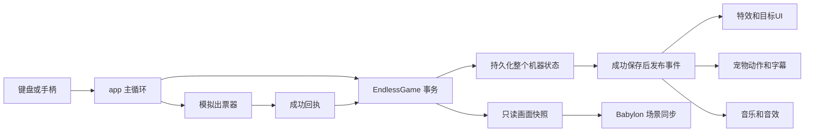

> 1.6.0当前完整规格见[文档26](26-1.6.0完整产品规格与决策记录.md)，封版与复验见[文档27](27-1.6.0封版与交付记录.md)。以下保留对应阶段记录，当前规则以新规格优先。

> 1.5.1已重新整理，当前工程结构以[1.5.1工程说明](21-1.5.1工程结构与整理验收.md)为准。下文保留此前结构记录。

# 文件与代码结构

## 活跃工程树

```text
game/
├─ src/client/
│  ├─ app.mjs                 唯一运行编排、启动和主循环
│  ├─ aim-input.mjs           方向键/横轴加速与细调
│  ├─ storage-keys.mjs        持久状态键，延续V15数据
│  └─ debug-api.mjs           ?test=1 才加载的自动测试入口
├─ src/core/
│  ├─ index.mjs               对外导出
│  ├─ core.mjs                状态机、事务、投币、发射、结算与出票入口
│  ├─ config.mjs              实验参数及配置校验
│  ├─ geometry.mjs            飞行、碰撞、落格、弹道预测与机会采样
│  ├─ board-policy.mjs        建盘、补充、整理、暂存与归位
│  ├─ endless-flow.mjs        默认顶部波次、压力、缓冲与随机色团
│  ├─ protection.mjs          最近铺球及支撑路径保护
│  ├─ special.mjs             炸弹、连锁、星星目标与阶段抽奖
│  ├─ ledger.mjs              奖励去重、出票批次与回执核销
│  ├─ storage.mjs             MemoryStore / BrowserJsonStore
│  ├─ simulator.mjs           模拟出票设备与证据记录
│  └─ migration.mjs           老状态显式迁移辅助，不自动执行
├─ src/presentation/
│  ├─ scene.mjs               当前PresentationScene、装填、补球、轨迹与帧动画
│  ├─ scene-base.mjs          FullScene：盘面同步、炮台、球托、彩票收集台、顶栏
│  ├─ sprite-layer.mjs        Region：引擎、相机、贴图、着色器与基本图元
│  ├─ guide.mjs               渐小渐淡的珍珠引导线、反弹点与对象池
│  └─ event-view.mjs          已提交事件映射为旧场景的轻量反应
├─ src/feedback/
│  ├─ effects-ui/effects-ui.mjs  消除、爆炸、掉落、飞票、补球和目标UI
│  ├─ pet/                    宠物控制、绘制、字幕与Babylon适配
│  └─ audio/                  单音频上下文、音乐层、音效、短角色音
├─ assets/images/             背景、泡泡图集、器具与历史骨架贴图
├─ assets/fonts/              站酷快乐体及OFL许可证
├─ assets/audio/              实际加载的32个WAV
├─ assets/licenses/           原始资源来源和语音清单
├─ vendor/babylon/            Babylon.js 9.30.0、许可证、版本
├─ tests/core/                账务、特殊球、随机建盘与堵塞边界测试
├─ tests/helpers/             浏览器发现、模拟玩家策略
├─ tests/browser/             集成、装填、引导线、吸附和补球验证
└─ tools/                     本地静态服务、启动、检查与浏览器测试编排
```

## 数据流和责任



core/ 不导入 Babylon、DOM、音频或美术模块，能够独立在 Node.js 中测试。画面层消费快照和已提交事件，不能加球、抽奖、修改奖励或提前减少待出票。

核心 tx() 顺序是复制旧状态、执行逻辑并收集事件、校验、保存新状态、替换当前状态，最后发布事件。保存失败会停机；特效订阅者失败不回滚已经提交的奖励。eventId、revision、causeId/shotId 将同一发的效果串起来。

app.mjs 负责一次 RAF 主循环：处理输入→推进核心→设备模拟→同步快照→消费事件→更新反馈和宠物→渲染。当前音频只有一个 AudioContext。新模块应加入这个循环和事件通道，不自行创建第二个核心实例或持续计时循环。

## 如何找到修改入口

| 想修改什么               | 首先查看                                                  |
| ------------------------ | --------------------------------------------------------- |
| 一币球数、速度、基础奖励 | core/config.mjs；同时看状态迁移约束                       |
| 出球颜色、消除与掉落结算 | core/core.mjs 的 fire、settle                             |
| 新泡泡来源、拥堵处理     | core/board-policy.mjs                                     |
| 炸弹和星星奖             | core/special.mjs                                          |
| 真实投币和出票           | client/app.mjs 的 coin/device调用、core/ledger与simulator |
| 球体、炮台、球托、收集台 | presentation/scene-base、sprite-layer                     |
| 装填和弹性动画           | presentation/scene.mjs                                    |
| 轨迹的长度/渐变          | presentation/guide.mjs；实际碰撞仍在geometry              |
| 消除、连锁、补球提示     | feedback/effects-ui/effects-ui.mjs                        |
| 萌宠动作、姿态、说话字幕 | feedback/pet/controller、dragon、lines                    |
| 音乐节奏、音效优先级     | feedback/audio/cues、audio                                |
| 页面提示文字和控制台     | index.html、style.css、client/app.mjs                     |

继承链仍为 PresentationScene→FullScene→Region，这是从原型演进保留下来的技术债。此次清理去掉了已关闭的重复消除系统 ResultEffects；旧宠物骨架仍由基础场景创建但在入口隐藏，当前宠物来自独立反馈模块。下一次渲染重构可以把炮台、盘面、HUD进一步组合化，不宜和奖励算法改动混在一起。

## 配置和版本

package.json 的1.0.0是产品工程版本；core/config.mjs 的 experimental-special-v4-1 是现有规则配置版本；schemaVersion=1是状态结构版本。三者含义不同，整理时没有为了改文件名修改规则版本或存档schema。

STORAGE_KEYS 沿用 bubble-integrated-v15-machine/device。改键名会创建新状态；它必须当作数据迁移处理。src/ 已无 demo-vXX、gameplay-vXX 或 implementation/ 外部目录依赖。
