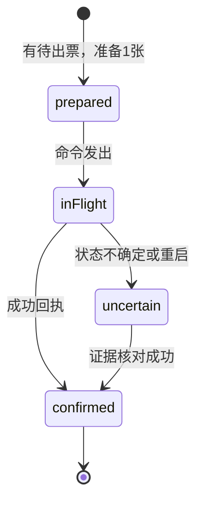

# 状态、账务与设备

## 当前状态保存

浏览器localStorage存两份JSON：机器状态和模拟出票器证据。核心每次事务保存整个机器快照，包含schema、config、revision、eventSequence、随机流、盘面、reserve、发射中的球、付费余额、投币receipt、阶段固定奖和ledger。

BrowserJsonStore 是浏览器尽力持久化，不代表已经完成设备断电耐久性认证。当前逐帧飞行与瞄准可能频繁保存整份JSON；奖励、receipt、回执历史会不断增长。长时间商用前需要更合适的原生持久存储、快照/日志压缩与压测。

## 关键账务规则

投币receiptId重复提交相同币数不会重复加球；相同ID不同币数会报错。奖项rewardId重复提交不会重复加奖；相同ID不同数量会报错。出票evidenceId重复反馈不会重复扣待出票。

```text
待出票 = ledger.earned - ledger.confirmed
付费余球 = 已购球数 - 已结算付费发射数 + 已退款发射数 - 当前飞行中的付费球
```

待出票包括prepared、inFlight、uncertain中尚未核销的部分。飞票动画、吐纸动画、发出出票命令或播放奖效，都不代表已实际出票。

## 出票批次状态



当前ledger每批请求1张，同一时刻只允许一个未完成批次。只有confirmDispense接收到可信的累计observedTotal并通过校验，confirmed才增加，待出票才减少。不确定状态会挡住下一批，避免未经核对的重复出票。

加载存档时，旧inFlight会转成uncertain。模拟设备的持久证据可以帮助核对；若没有证据不能直接当成功或简单重发。

## 核心可接入方法

| 方法                                                | 当前用途                               |
| --------------------------------------------------- | -------------------------------------- |
| coin({receiptId, coins})                            | 唯一投币回执增加余额                   |
| fire()                                              | 根据余额决定付费/免费；忙碌时拒绝      |
| setAim(angle), advance(dt)                          | 输入与逻辑时间推进                     |
| snapshot()                                          | 画面用只读投影，不包含完整奖池抽取细节 |
| exportState()                                       | 完整机器备份，含账务与随机状态         |
| prepareDispense()                                   | 持久准备下一张出票                     |
| sendDispense(batchId)                               | 持久记录已发送                         |
| confirmDispense({batchId,evidenceId,observedTotal}) | 核销真实成功数量                       |
| markDispenseUncertain(batchId)                      | 锁住无法确认的义务                     |

真实设备适配需要定义：设备唯一标识、输入脉冲去抖、重复receipt、成功计数/回执、故障、超时、掉电后核对和证据保存。当前SimulatedDispenser只验证软件闭环，不能证明真实设备已支持这些字段。

## 配置修改与迁移

加载状态会验证schemaVersion和完整配置一致。直接改ballsPerCoin或奖励参数，会使旧存档与新配置不匹配；这是一项保护，不应捕获错误后默默新建机器。

未来参数管理应引入：备份→空闲且已结算边界→验证新配置→显式迁移→保留币、球、已赢与待出票→版本审计→可回滚。改变一币球数会影响历史receipt的余额校验，必须设计历史购买记录/配置版本，不可只改常量。

migration.mjs 的 migrateV2State 是针对早期无content的V2快照的辅助函数，不能作为任何未来版本的通用迁移器。此次目录整理沿用原键、schema和配置，没有调用它。

## 联网与可信边界

目前没有联网、服务端、账户或授权验证。浏览器端代码和存储可被本机人员修改。未来轻联网可以承载设备授权、签名配置、事件上报、远程诊断与联网专属活动；联网本身不能保证整个客户端无法复制，也不能替代本地可靠出票。

建议本地基础玩法和已承诺出票离线可继续，联网活动需要服务端确认。断网、授权过期或更新失败，不应清除已赢彩票和付费余额。具体运营政策需要产品确认。
