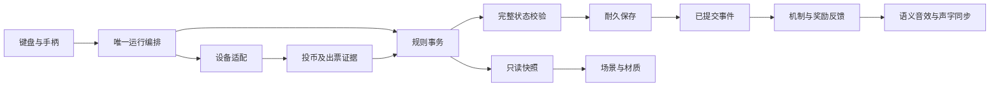

# 1.5.1 工程结构、整理内容与接手指南

产品基线：1.5.0（已认可1.4.2的冻结封版）；当前维护工程：1.5.1。规则配置、schema、浏览器存储键、已获票/待出票义务和资源均不改变。

## 1. 目录职责

```text
泡泡龙/
├─ 启动游戏.cmd                   双击运行当前工程
├─ README.md                      唯一项目入口
├─ game/                          当前唯一维护工程
│  ├─ index.html / style.css      页面、控制面板与响应式布局
│  ├─ package.json / lock         版本、脚本、固定开发依赖
│  ├─ src/
│  │  ├─ client/                  输入、运行编排、反馈组合、QA入口
│  │  ├─ core/                    纯规则、事务、耐久状态、出票义务
│  │  ├─ presentation/            Babylon场景、器具、装填和轨迹
│  │  └─ feedback/
│  │     ├─ mechanisms/           双彩与导电的事件适配和专属演出
│  │     ├─ environment/          动态环境与Babylon图层绑定
│  │     ├─ orbs/                 球材质与特殊属性外观
│  │     ├─ rewards/              奖励语义、字幕、配音调度
│  │     ├─ effects-ui/           通用消除/掉落/飞票/宝箱/UI
│  │     ├─ pet/                  整体萌宠绘制、动作与气泡
│  │     └─ audio/                唯一音频上下文、混音、音效、视觉cue
│  ├─ dev/mechanisms/             独立模拟预览、假事件、预览录屏
│  ├─ tests/core/                 纯核心规则和账务测试
│  ├─ tests/feedback/             表现所有权、声字时序及资源生命周期测试
│  ├─ tests/browser/              键盘实机、像素和存档测试
│  ├─ tests/helpers/              策略、浏览器发现、样本/比较工具
│  ├─ tests/fixtures/             固定事件样本与历史回归数据
│  ├─ tools/                     启动/静态服务/检查/封版/对照/盘点
│  ├─ assets/                    图片、字体、WAV、许可记录
│  └─ vendor/babylon/             离线引擎及许可证
├─ docs/                          产品规格、工程说明与历史决策
├─ archive/                       历史Demo、Agent交付和规划；非运行依赖
│  └─ maintenance-scripts/        旧1.0整理脚本，禁止当作当前发布工具
└─ output/
   ├─ releases/v1.5.0/            冻结源码、SHA清单、ZIP；不要覆盖
   ├─ releases/v1.5.1/            整理版源码、SHA清单、ZIP；不要覆盖
   └─ verification/v1.5.1/        对照JSON、实机报告与截图
```

运行不依赖node_modules、archive、output或dev；node_modules只用于开发工具。dev只在主动打开预览页时运行，正式app没有反向导入。开发预览地址为/dev/mechanisms/preview.html，有假数据且不接账务。正式机台封装可完全不带dev和测试入口。

## 2. 此次实际整理

| 原问题 | 1.5.1变化 | 保持等效的方法 |
| --- | --- | --- |
| core同时承担事务、校验和长结算 | 完整校验移入state-validation；付费结算移入settlement | 保持执行顺序、传入同一个事务草稿和事件收集器；原方法作为API委托 |
| 坐标/邻接有核心重复实现 | core.pos/neighbors调用geometry的唯一规则函数 | 不改变运算式或浮点排序，逐事务和坐标对照 |
| app混有较长的音效映射 | 拆presentation-cues，明确视觉到达与音效接力 | 同一个reward-unit-arrive回调；同一个音频对象 |
| 目录名沿用临时交付命名 | assist-network改mechanisms；stage-polish按环境、球、奖励拆分 | 更新所有源码/测试相对导入，不改模块算法 |
| 预览/假数据/录屏器在运行src | 移至dev/mechanisms | 正式依赖图无dev/tests导入；预览可独立访问 |
| 工程/锁文件版本不一致 | package及lock统一1.5.1 | 不改依赖版本，不影响冻结包原文件 |
| 旧整理脚本会写1.0清单 | 移入archive/maintenance-scripts | 当前tools只保留可用于当前版的工具 |
| 封版工具无版本匹配检查 | 检查package版本；支持明确基线版本；已有包拒绝覆盖 | 继续为每个文件生成实际SHA-256 |
| 没有可复跑的两版等效证据 | 加verify-baseline和browser/baseline | 同种子逐提交比较；同帧状态与合成像素比较 |
| 旧补球测试依赖即时快进 | 改用固定种子、真实键盘、实际延迟/移动状态 | 测试等待实际事件ID，而非假设固定发数或日志长度永久增长 |

不对已有代码大范围重写，不换引擎、不改变参数、不删历史发布包或用户存档。保留旧密集策略关闭时的pockets/safeRows，兼容与对照测试明确标记；不会把它们悄悄接回当前默认主线。

## 3. 核心文件职责

| 文件 | 边界 |
| --- | --- |
| core/index | 对外稳定出口，客户端只从此取游戏/存储/模拟设备 |
| core/core | 初始化/恢复、唯一事务、投币、发射、推进、设备命令与只读快照 |
| core/state-validation | 配置相关状态、球几何、额度守恒、彩票账、机制及波次校验 |
| core/settlement | 吸附→各色匹配→机制闭包→掉落→目标/奖励→维护/波次→下一色/资格的固定顺序 |
| core/config | 默认原型参数、配置合并与安全校验；不是后台界面 |
| core/geometry | 六邻、格中心、连续碰撞、落格、预测和角度机会扫描 |
| core/board-colors | 新系统球的连通团权重配色，不改老球 |
| core/board-policy | 初盘、库存、维护/保护/暂存，默认波次入口及旧策略兼容 |
| core/endless-flow | 多数前沿、压力、缓冲、待波次及顶部行推进 |
| core/protection | 最近铺路球及真实顶部支撑路径 |
| core/special | 三星轮次、公开奖量、基础炸弹和星收集 |
| core/mechanics | 双彩资格、各色匹配、网络生命周期、炸弹/闪电统一闭包 |
| core/low-opportunity | 付费消费资格、余球窗口、已有系统球变炸弹及延后/结束 |
| core/ledger | 唯一奖、出票准备/发送/不确定/证据核销 |
| core/storage | 内存存储与浏览器JSON存储适配 |
| core/simulator | 独立模拟物理出票证据，不属于规则奖量 |
| core/migration | 明确的历史格式迁移工具，不能自动清空不匹配状态 |

## 4. 表现文件职责

client/app负责唯一主循环及事件队列；aim-input负责摇杆曲线与短按长按；storage-keys为持久键常量；debug-api仅?test=1加载；presentation-upgrade组合机制、环境、球材质、奖字/配音并协调特效所有权。

presentation/sprite-layer是Babylon基本图元、相机与底层纹理；scene-base构建背景、炮台、球托、票口、球与HUD；scene补球移动、装填、轨迹和逐帧动画；guide负责珍珠池；event-view将已提交事件映射成场景反应。

| 目录 | 文件职责 |
| --- | --- |
| feedback/mechanisms | core-bridge将真实事件变表现包；director决定时序/所有权；renderer绘制双色及闪电；art基础画法；integration提供组合生命周期和临时可见性恢复 |
| feedback/environment | background维护环境时间/能量脉冲；room-layer将透明环境画布绑入场景背景层 |
| feedback/orbs | orb-material替换就绪的球shader并回收；special-orbs绘制星/炸弹立体标记 |
| feedback/rewards | progress-bridge从业务合并语义；reward-voice调度声音及实际输出时钟；voice-library合法素材槽位；reward-words绘制短公告 |
| feedback/effects-ui | effects-ui归组通用结果、补球通知及阶段动画；treasure画宝箱/星；reward-flights逐票到达；reward-counter协调业务余额和显示余额 |
| feedback/impact-vfx | 多层爆炸绘制，纯表现不持久化奖量 |
| feedback/pet | lines定义文案、动作优先级/时长；controller调度；dragon整体画宠物；babylon-adapter对接动态纹理和口部气泡 |
| feedback/audio | audio音频加载/生命周期/混音；cues音效与事件映射；character短角色音；score-tick本地得分音；presentation-cues视觉里程碑同步发声 |

完整模块、导入关系、文件大小和工作区各区体积在1.5.1-project-inventory.json，可通过audit-project重新生成。不能只看文件名决定删资源：旧宠物贴图仍由基础渲染构建后隐藏，旧球图是对照方案；当前默认看不见不等于没有依赖。

## 5. 数据流和修改约束



新功能先定义规则状态、触发/继承/恢复/奖量，再定义已提交事件，再接效果。任何动画回调只能修改表现计时，不改paidAmmo、ledger或目标收集。碰撞、落格、机会扫描不各写一套“差不多”的算法。添加事件不靠单个浏览器截图验收；添加素材需检查许可证和资源预算。

适合多人协作的边界：玩法与数值负责core及纯模拟；美术负责presentation/feedback且不加奖；声音负责audio及rewards调度；设备负责证据适配和耐久；主编排与集成由负责人统一修改。多个Agent不要同时改app、settlement或同一个shader，先约定接口和可修改文件。

## 6. 执行与复验

在game目录执行：

```powershell
node tools/server.mjs
node tools/check.mjs
node --test tests/core/*.test.mjs tests/feedback/*.test.mjs
node tools/test-browser.cjs
node tools/verify-baseline.mjs
node tests/browser/baseline.cjs
node tools/audit-project.mjs
node tools/check-release.mjs
.\tools\package-release.ps1 -Version '1.5.1' -BaselineVersion '1.5.0'
```

发布包已经存在时最后一条会拒绝覆盖，属于保护。其他测试可重跑。本机需要Chrome/Edge或BROWSER_PATH；npm ci安装固定开发工具。独立拷贝game可运行；两版对照需要保留冻结1.5.0，verify-baseline可在第一个参数传基线game绝对路径，browser/baseline默认查同项目output/releases/v1.5.0/source/game。

测试均使用隔离端口/存储，不重置用户4210地址。UI像素测试人为固定视觉随机和帧时钟，避免把两次正常随机动画的不同误判为重构退化。游戏正常运行仍使用原来的随机与真实帧间隔。

已验证：480发混合输入（默认与旧策略，4种种子），11,189次完整状态和事件批次相同；47个资源文件SHA相同。五组同帧场景合成像素差0：免费、付费、发射装填、消除奖励、结算后。79项核心/反馈测试通过。八组浏览器回归及独立开发预览验证通过。完整浏览器报告和最终发布检查另见output/verification/v1.5.1。

“完全等效”以这些可重跑证据为依据，不宣称穷举所有未来输入、GPU和Android设备。后续规则变化应和1.5.0/1.5.1基线对照，并写清预期变化，而不是继续要求玩法改变后票量还完全相同。

## 7. 保留的技术债与后续整理

- PresentationScene→FullScene→Region继承链及隐藏旧贴图宠物仍保留；直接删掉构建链风险大，会牵动炮台和纹理。下轮可独立组合化并继续做像素对照，本轮不冒险以“清干净”改变效果。
- 默认密集盘与旧关闭策略存在分支，旧配置字段保留便于存档与对照。下一步若弃用旧策略，需要明确迁移和删测试政策。
- 当前整机状态复制/JSON持久化频繁，奖账与回执长时间增长；生产板卡需验证IO、日志压缩、事件归档与断电恢复，而不是现在盲目少保存几次。
- 开发事件样本中有大JSON，明确归为测试夹具，不是运行加载。archive和output保留大量历史文件，是追溯资料，不是当前运行负担。
- 校验当前限制9列；改成10列或缩球不能只改图片，需要物理/配置/所有映射一起验证。
- 自然配音槽位、生产数值、真正后台、联网和硬件桥尚未完成。结构整理不应被当成这些能力已上线。
