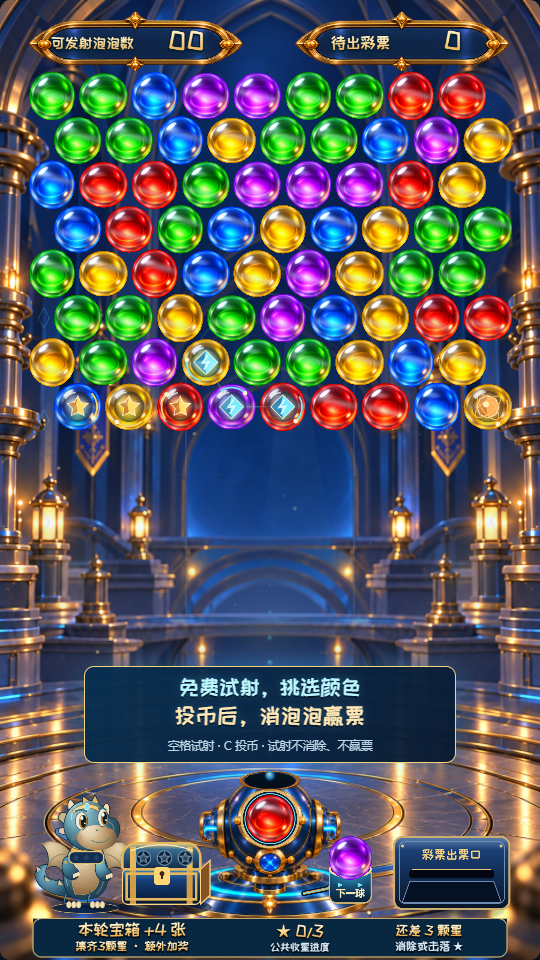
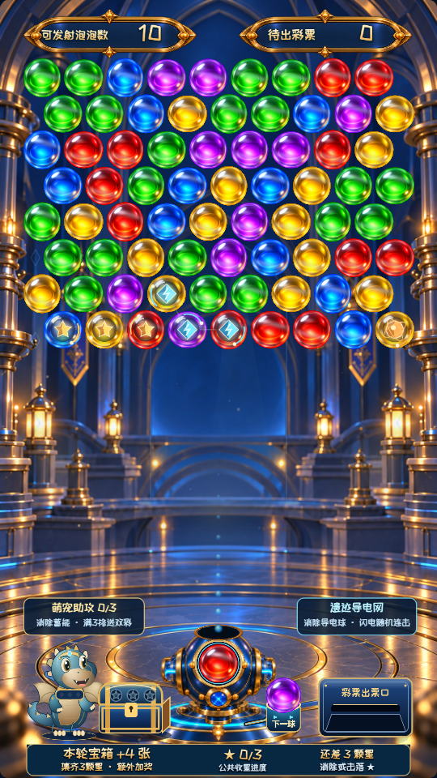
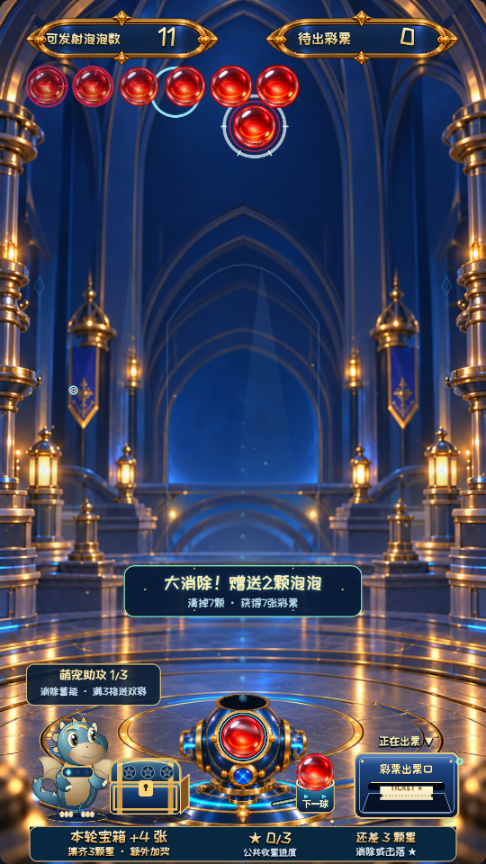

# 泡泡龙彩票街机：1.6.0 完整产品规格与决策记录

版本：1.6.0 已认可体验冻结版，玩法和表现等同于1.5.5。更新日期：2026-10-12。受众：产品、玩法数值、美术、声音、客户端、设备及后续接手团队。

本文件将1.5完整规格与1.5.2–1.5.5的全部新增决定整合为一份当前规格。已统一更新数量、空间分布、登场节奏、炸弹上限、赠球账务、音画和萌宠，不要求读者自行叠加历史补丁。本文以本次对话的产品决策、已交付说明和冻结版本的实际行为为依据。这里的“当前”均指上述版本，不把早期提案当成已实现功能。文档按功能组织，描述目的、规则、时序、表现和异常分支；不要求读者照抄现有代码。独立实现可换语言、模块组织甚至引擎，但必须保持本文定义的行为。

复刻分为三个层次：规则和账务可依据下述算法独立重做；手感和演出可依据尺寸、时序、分层及验收场景重做；逐像素相同还需要同一美术原图、字体及声音素材，文字无法唯一确定一张插画的所有像素。原素材及其许可证随发布包提供，可用于视觉对照；它们不是游戏逻辑代码。本文件不把原型参数称为已验证的商业赔率。

## 目录

1. 定位与关键决策
2. 完整玩家旅程与控制
3. 空间、碰撞、消除及出球
4. 无尽盘面与补球节奏
5. 炸弹、星星宝箱、双彩、导电和低余球机会
6. 彩票奖励、投币、出票和持久化
7. 美术、UI、动效、萌宠、环境和声音规格
8. 系统边界、数据与事件协议
9. 功能验收与复刻实施顺序
10. 开发过程与被替代方案
11. 未完成但讨论过的 idea

## 1. 定位与关键决策

### 1.1 核心价值

这是一台“打泡泡龙可以出彩票”的电玩城机台。彩票指机台吐出的兑换票券，当前网页使用出票模拟器。最重要的信息是：投币获得发射次数，消除和击落泡泡获得彩票，设备边玩边出票。不能把它做成只宣传萌宠、特效或排行榜，却藏起出票价值的普通消除游戏。

目标体验是熟悉的泡泡龙操作，加上街机的即时获奖、连锁演出和公共目标。玩家可以快速开始、接着前一人的盘面打；不登录、不建虚拟账户、不依赖持续重联网。已确认键盘/摇杆操作，不实现触摸或鼠标瞄准射击。

### 1.2 已确认的最终边界

| 项目 | 当前决定 | 设计理由 |
| --- | --- | --- |
| 游戏长度 | 无尽公共盘面；无60秒结束、Game Over或通关黑屏 | 更接近用币购买炮数的街机循环，方便持续投币和接盘 |
| 投币 | 1币10球，连续投币累加；工程配置保留可调整能力 | “币买球”直接易懂；后台编辑界面尚未实现 |
| 收益 | 消除或击落获得票，设备逐张出票 | 结果即时可见，同时尊重出票设备速度 |
| 主数字 | 可发射泡泡数、待出彩票 | 不要求理解积分、余额或“未结算”等工程词 |
| 免费状态 | 可以试射并切换当前颜色；不改盘、不获票 | 玩家有参与感，可以选喜欢的颜色再投币 |
| 公共继承 | 盘面、星星、双彩资格、导电球和未出票义务留在机器 | 不登录也能继续目标和残局，不虚构个人累计 |
| 风格 | 蓝金遗迹空间、彩色有光泽泡泡、左下萌宠；明显3D感 | 不追求纯3D，允许贴图、着色器和2D演出结合 |
| 引擎 | Babylon.js网页工程，本地资源 | 降低协作与迭代成本；不承诺以后必须换Godot |
| 平台 | 当前Windows浏览器试玩；Android板卡封装后续联调 | 先稳定体验，最终用实机验证性能和设备接口 |

早期“2币60–90秒”“60秒无复活”曾讨论和短期采纳，后被无尽买球方案覆盖。不能在复刻版本中同时保留倒计时结束和当前无尽规则。

## 2. 玩家旅程与控制

### 2.1 未投币

机器显示一个真实公共盘面，炮台内有当前球，下方偏右的球托有下一球位置；左上数量为00。屏幕下半部常驻：主行“免费试射，挑选颜色”，次行“投币后，消泡泡赢票”，小行“空格试射 · C 投币 · 试射不消除、不赢票”。提示不遮住主要瞄准走廊、宠物口部和顶栏。

按发射后，球按正常初始弹道飞出，可撞墙反弹。第一次碰到球堆或上边界时，变成向下弹走的免费球，不吸附、不消除、不收星、不触发炸弹/导电、不推进补球压力、不累计双彩、不新增低余球机会。向下离开发射器以下后结束免费飞行，进入0.2秒冷却。当前装填颜色按五色固定循环切换：红→蓝→绿→黄→紫→红。免费切色不重抽宝箱奖量、不改下一球、不消耗已蓄满的双彩资格。

免费球已在飞行时投币，当前飞行仍是免费球；新增球数用于后续付费射击，不把已发出的免费球变成获奖球。投币不换掉已选中的装填色。

### 2.2 付费及续投

每个有效投币回执增加10球。发射被接受时扣1球，不等消除后再扣；已在飞行、冷却、等待补球或盘面移动期间，不能重复扣球。用户在补球移动中按发射可保留一次等待意图，移动与核心冷却结束后再发，不累计无限连发队列。

付费射出当前颜色后，发射前的下一球立即成为新的装填色，并从球托沿弧线滑进炮口。射出的球结算后，才抽取新的下一球。可继续投币增加球数，不重置盘面或公共进度。余球归零后回到免费提示；尚未出票的彩票继续出票。大消除赠球并入同一可发射额度，正常消除和获票；内部paid模式表示消耗有效发射次数，不意味着每颗赠球都需要额外付款。

### 2.3 输入与微调

| 输入 | 行为 |
| --- | --- |
| ←/→或A/D | 左右瞄准，短按慢移、长按加速 |
| Shift | 精细瞄准 |
| 空格 | 发射一球 |
| C、试玩投币按钮 | 模拟投1币，新增10球 |
| P、暂停按钮 | 暂停/继续 |
| F、全屏按钮 | 进入全屏 |
| 手柄横轴 | 模拟量瞄准 |
| 手柄方向键14/15 | 数字左右瞄准 |
| 手柄按钮0、8、9 | 发射、模拟投币、暂停 |

瞄准范围是左右各1.16弧度，约66.46°，0指竖直向上。数字方向初始速度0.26弧度/秒；持续0.18秒后开始加速，在额外0.42秒内渐增到0.74。Shift时0.16。模拟横轴绝对值≤0.16为死区；剩余行程归一化后取1.7次幂，再乘最大0.74（精细模式0.16）。数字和模拟输入合并后总速度限制在±0.74。方向反转或释放时重置长按计时，避免微调也以最大速度启动。

失焦、隐藏标签或手柄断开暂停操作与动画；回来后不把离开期间的时间补算成盘面下压。暂停不取消已经入账的出票义务；当前模拟设备仍可按真实帧时间出票，这是设备层与游戏动画暂停的区别。QA保持后台运行是测试选项，正式玩家不依赖它。

## 3. 空间、碰撞、消除与出球

### 3.1 逻辑空间

采用9列交错六角格；行从顶部0开始，列0–8。相邻并非只看上下左右。默认物理参数如下，单位均为逻辑空间单位，时间为秒。

| 参数 | 值 | 意义 |
| --- | --- | --- |
| 列数/色数 | 9 / 5 | 当前整套边界与UI以此为基础 |
| 球半径/直径 | 0.44 / 0.88 | 碰撞圆和基本图样尺寸 |
| 横格距/纵行距 | 0.94 / 0.814 | 小间隙与六角堆叠 |
| 顶部y | 7 | 顶行球中心 |
| 左右墙 | ±4.55 | 球中心反弹界限为±4.11 |
| 炮台y | -6.25 | 发射原点参考 |
| 器具危险边界y | -4.65 | 球底部触及则应急维护 |
| 发射速度 | 19 | 与瞄准角分解为水平、竖直速度 |
| 发射起始偏移 | 朝瞄准方向0.7 | 避免弹体从炮台内部出现 |
| 冷却 | 0.2 | 单发结算后最短间隔 |

格中心横坐标为“(列−4)×0.94，加上奇数交错行0.47，再减0.235”；纵坐标为“7−行×0.814”。交错行由“行号+盘面奇偶状态”的奇偶决定。插入顶部一排时旧球行号加1，同时切换盘面奇偶状态，使旧球水平位置保持不变。

若当前行是交错奇行，斜向额外邻居在列+1；偶行在列−1。六邻包含同行左右、上一行同列和偏移列、下一行同列和偏移列。负行、越界列不合法。所有生成、连通、导电、掉落、维护和弹道预测共用这一套邻接定义。

### 3.2 飞行与吸附

球匀速直线移动，撞侧墙仅反转水平速度，不加随机偏移。与盘面球进行连续圆交点计算，接触距离使用“两倍半径减0.016”，避免贴边浮点误差。一个子步里先找到最早碰撞；同时接触时按更靠上行、再更小列确定目标。到达顶部也产生接触。

每次核心推进最多0.25秒，拆成不超过0.005秒的小步。前端正常帧上限0.05秒；不得因卡帧穿过球堆。一次飞行分段最多处理32段墙反弹。判定和预测必须用同一碰撞规则，不能让指引线走一种弹道、实际球走另一种。

碰到球后，从目标的空六邻格里选择距接触球中心最近的格；距离相同按行、列排序。碰顶部则从顶行空格选择。吸附到选定格后再计算结果。如果没有合法格，发射球退回额度，记录退款，不直接吞掉付费次数或虚构获票；双彩资格同时退回可用状态。

### 3.3 普通消除与掉落

以新吸附球为起点，寻找同色六邻连通组；包含新球至少3个才成功。不要求一条直线。成功组先扩展炸弹和导电机制，再从盘面移除。随后从所有顶行球沿任意颜色六邻寻找仍有顶部支撑的球，其余球作为掉落移除。直接消除与掉落用唯一球ID区分，一个球不能在两类中同时计算。

击中并吸附但不三消也是有效付费发射：球留在盘面，形成下一次铺路；不获票、不蓄双彩。特殊球只是普通颜色球上的属性，不是“碰到它就自动爆”。仅作为掉落结果的炸弹或导电球，不触发爆炸或导电。

### 3.4 初始与后续颜色

首次创建机器状态由浏览器安全随机源提供种子，之后使用持久化、可重放的32位伪随机流。主流推进规则为：原值乘1664525、加1013904223，保留无符号低32位，再除以4294967296。初始当前球和下一球从五色等概率选。

每次付费结算后，新的下一球从“当时盘面实际存在的不同颜色”中等概率选，不按球数加权，也不为了玩家即将三消偷偷改色。没有剩余颜色时保留已抽的下一球；延迟补球完成后，如果该下一色不在新盘面中，再从新盘面的不同颜色重选。已经锁定的当前球和在途球不能事后重抽。

宝箱奖量和双彩副色使用各自独立的持久化随机流，避免调背景、免费试射或进行机会扫描改变它们。当前随机是原型可重放工具，不是加密开奖或联网防作弊系统。

为复现相同种子的顺序，初始化依次为：创建八排（每系统新球一次主流加权抽样）→创建本轮宝箱→抽当前球→抽下一球→初始化双彩与导电→初始化低余球与内容预算/波次。第一轮宝箱流从“此刻主流状态异或0x00a531f2”起步，按上述乘加推进一次后选奖；之后仅在新轮次时推进此流。双彩流初值为“完成两次装填色抽样后的主流状态异或0x73c921ab”，仅真正抽副色时推进；没有候选颜色时不推进。视觉闪光、珍珠随机长度不能消费以上三条业务随机流。

### 3.5 系统球生成配色

新初盤按行、列顺序生成72个球，即8排×9列。每个待生格对五种颜色分别计算：它与周围真实同色团连接后的总团大小；同一团接触多次只算一次；若向左延伸为长同色条，也记录长度。

大小1/2/3/4/5/6的候选权重分别为1/1.25/0.9/0.5/0.22/0.08；超过6个或生成长于3球的横向条，权重为0。按权重总和一次抽样，不重复抽到满意为止、不套重复图案。极端旧盘所有候选权重都为0时，从造成连通团最小的颜色中等概率选，以保证算法有界。

这控制的是自动生成，并不禁止玩家把多个小团连起来打大消除。已有公共盘面和暂存旧球不能为满足上限而改色。顶部波次的新颜色检查下移后旧盘和同波次已生成的球，不能只看左侧。参考Frozen Bubble的真实邻接连通判定思路，但上述权重与团大小限制是本项目自己的调节方案。

## 4. 无尽盘面与补球节奏

### 4.1 为什么不用逐发机械回填

用户要求大部分时间七八排，但也要求大消除真能留出空间。若消掉多少立刻补多少，奖励缺乏清空感，布局像没有改变。现行方案不填刚打出的洞，不按固定“第N发”强行补球。新球只从顶部整排进入，依照多数列前沿、未消除压力和恢复窗口决定时机。

“盘面排数”不是最深一个孤立球，也不是球数除9。对九列分别计算最深球行号加1，空列为0；排序后取第6个数作为多数前沿。另保留最深行数作物理安全判断。因此少量铺路球不会单独触发满场恢复或阻止恢复。七八排是节奏目标，不是逐帧强制不变量。

### 4.2 持久化波次状态

保存压力值、阈值、缓冲发数、距上次波次的付费发数、累计波次数、是否已给本次大消除缓冲，以及待执行波次（触发发射ID、原因、排数、剩余延迟）。初始压力0、阈值4、缓冲0。每个完成波次之后，压力归0，距波次发数归0，缓冲资格重新可用；新阈值从3/4/5等概率选择。

一次有合法落点的付费结算：距波次发数加1；有直接消除时压力减1但不小于0，无直接消除则压力加1但不超过阈值。消除和掉落总计至少12个且本波次尚未给过缓冲，给予一个后续发射的缓冲；连续大消除不会每次重置到无限缓冲。普通后续结算消耗该缓冲。当前触发大消除本身也属于休息边界。

### 4.3 触发与排数

满足以下任一条件且未安排另一待执行波次、最深行数小于13、有足够可用库存，安排顶部波次：

- 多数前沿小于7，距上波次至少2发，且不处于缓冲。此恢复允许由一次成功消除触发，不要求先打空几发。
- 本发没直接消除，多数前沿小于8，压力达到阈值且无缓冲。
- 盘面完全空了。

完全空场计划7或8排；低盘恢复计划“7减当前多数前沿，再随机加0或1”，最多6排；压力推进1排。最终再限制到“13减现有最深行数”。非空盘至少有9个库存才能推一整排；空盘可以用剩余可用库存生成不满的一排。系统库存足够时优先实现整排。

本发有消除，待入场延迟1.45秒；无消除0.7秒。延迟期间不再接受付费发射；前端让消除、掉落和奖励先播放，显示新球来临提醒。延迟是核心状态，刷新后按保存的剩余时间继续，不直接生成第二波。

### 4.4 波次执行

先将旧盘所有球下移一行，交错状态翻转，保持ID、颜色、属性、水平位置。顶行逐列新增球；暂存库存优先返回，返回球不重抽颜色和属性；没有暂存球才消耗一个生成额度来创建新的系统球。多个计划行按上述规则连续插入，各行计入补球次数。

波次本身不赠票、不扣球、不增加双彩、不完成星星目标。完成后可以给新系统球装饰星星/普通炸弹；导电网按它自己的重新登场条件检查。前端盘面下移和新球入场分层播放，不能把新球当成刚击中的吸附球。

### 4.5 库存守恒与维护

初盘72球，初始化时系统总内容预算扩至108，余36为生成额度。任何时候“盘上系统球+暂存系统球+生成额度=108”。消除/掉落系统球时归还等量生成额度；玩家铺球不算系统预算。该预算防止维护、回归、填洞或刷新凭空创造可兑换的新内容，不是每币返奖率。

默认普通维护边界为第10排（行号≥10）；物理危险条件为球底部y≤−4.65，优先于保护。最近6发留下的玩家铺球及其一条实际连到顶部的支撑路径优先保护。超过普通边界、没有保护的球可移入暂存；没有合法落格时可应急移开最下层。移走后不再有支撑的附带球也进入暂存。维护不是中奖，不收星、不爆炸、不给票。

暂存玩家球最多18个，超出时按最老铺球先退役；系统球不直接销毁，而是暂存后随顶部波次回归。物理器具安全可覆盖最近铺球保护，确保无尽不会因为球堆触底而永久无法玩。无尽不等于盘面永不整理，整理必须有可见说明、不能冒充消除获奖。

关闭当前密集盘策略的旧pockets/safeRows只保留作兼容和算法对照，不是1.6默认玩法。旧“每五发補球”“固定两两方块色盘”“逐发补到固定数量”“固定24发球潮”均不代表当前规则。

## 5. 特殊机制

### 5.1 普通炸弹

炸弹保留底色，标记为带有能量核心和金属环的爆破球。它被三消组或其他机制的直接清除触及时，引爆自身及六个实际邻接球，无视邻球颜色。被爆到的另一个炸弹再引爆；被爆到导电球可启动闪电。所有移除和触发按球ID去重，不能因为多条因果路径叠加票量。

基础装饰：库存（盘面+暂存）普通炸弹少于2，并且从上一基础炸弹计划以来至少经过3次补球（首个不受间隔），从尚无属性的系统球中选更靠下、更靠右的一球标记。一次装饰最多安排一个，最开始通常一个。机会炸弹另按抽中的2–5颗整批登场，不设总炸弹数量上限；不能把“基础少于2”误当成全机最多2颗。

### 5.2 萌宠寻宝：三星与公开宝箱

每轮有3颗星星目标。绑定既有、无属性的系统球，优先更靠下，再从左到右选。没有足够候选时不凭空新增三球，后续正常补球/装饰时逐步补足目标。星球保留颜色，直接消除或无支撑掉落均能收集；移入暂存不算收集。每个目标ID只收一次。

每轮开始即固定宝箱奖励：4张60%、8张30%、16张10%，并把奖量公开显示在宝箱附近。玩家看到0/3、1/3、2/3及“集齐3颗加奖”等简短说明，最后一颗收集后开箱，获奖数量等于早已公开的本轮奖量。刷新、免费试射或投币不重抽。

三颗收齐的同一付费结算可同时获得普通球奖与宝箱额外奖，分别记账。宝箱每轮只有一个奖励ID，重复事件或刷新不重复加票。完成后核心立即创建下一轮；画面要先播完上一轮星星飞入和开箱，再显示新的奖量，避免玩家觉得刚开奖数字就变了。残局与收集进度公共继承。

### 5.3 萌宠双彩助攻

一次普通付费发射产生实际直接消除，蓄能增加1格；一发不论消几个只加1格。未三消、免费球、补球、掉落动画、出票回执不充能。共3格；蓄满后下一发被接受的付费球获得双彩资格。没投币时可继续免费选色，但资格和副色保留。

蓄满时，从现盘不同颜色里排除即将装填的主色，按独立随机流锁定副色；没有别色时副色为空，明确退化为单色，不为强行凑双彩造出不存在的色。副色一旦确定，免费切色不重新抽；主色后续恰好切成与副色相同，按一种颜色计算。

发射时主副色共同显示在一个球中；落格后，各颜色分别从落点起查找对应颜色的六邻连通。落点球在两个搜索中都是起点，但每色组都必须独立达到3球，不能把红2+蓝2合为4球便同时消。达到条件的组取并集，发射球和其他球各移除一次，再进入炸弹/导电闭包。

双彩一发成功附着即消耗资格，不要求必然消除；消耗后蓄能归0，这一发不再次给自己充能。无合法落点退款则恢复原资格及颜色。资格包含公共序号、固定副色、充能/就绪/在途三种状态，保存与崩溃恢复不得重新获得一次。

表现包含三格充能、能量向宠物/发射器流动、就绪短提示“下一发双彩，两色分别三消”、炮内和飞行球双色表层及命中后两组对应颜色能量。不得显示成两颗独立弹体或暗改碰撞半径。

### 5.4 遗迹导电网与沿线随机击落

新机器初始化时，在靠下的尚无属性系统球中选择2–3个实际相连的球标记导电节点，默认最多3个。节点保留底色，有菱形能量核心和外环；相邻同网节点之间显示可见线段。显示网络线是属性说明，伤害沿实际球邻接走，并不只限于导电节点。

只有导电球被直接移除时启动；单纯掉落不启动。启动后选择实际相邻路径上的任意颜色球额外电掉：一次共享额外预算随机为3–6球，不保证拥挤程度不足时一定凑够。已经属于本发三消的球可作为真实邻接桥，不能重复花预算或重复奖励。路径可在真实相邻分支回溯，不能跨空洞跃迁；全次最多12段路径。

为了预判、结算和重启恢复一致，电击的“随机”由当前系统球ID集合及触发节点决定，采用无状态散列选预算与候选顺序，不消耗主出球或奖量随机流。排序系统球ID后以竖线连接；初值2166136261，逐字符异或字符码、乘16777619并保留低32位。首次导电预算为“3+触发输入散列模4”；每步对当前位置到邻位置的输入散列排序选第一个真实候选。初始导电球本身属于正常直接奖，额外路径球也按直接奖，不另给“导电倍率”。

沿线电到炸弹则引爆该炸弹，爆到导电球可继续传导；各路径共享剩余预算和已击球集合。原三消/炸弹直接范围与闪电附带移除取并集。画面播放白蓝主电弧、辉光、局部分叉、被击球能量晕与破裂，炸弹接触点加爆炸；装饰分叉不能偷偷扩大实际伤害。

网络ID在盘上或暂存仍有节点时保留；全部收获后结束。新网只能在真实付费补球后、距上次网计划至少3次补球且距上次激活/结束至少2发时尝试创建；需有至少2个相连候选。投币、刷新、免费操作不自发补网。导电效果不明确的问题已通过“随机电掉沿线任意颜色球”和真实连锁电弧替代早期只传同色/只看静态标记的方案。

### 5.5 最后一两球的公共机会

目的：球数快用完时让盘面出现可追求的爆破机会，同时只提示真实余球，不对玩家宣称“最后两球必有奖励”。屏幕可写“还剩两球了/还剩一球了”和“投币可补充泡泡，继续游玩”；不能写“最后两球奖励加倍/必中”。玩法说明里仍披露实际机会规则，不能伪造奖率。

默认每实际购买10球提供一个机会额度；消耗到距最近资格至少10个有效付费球且还剩1–2球时，才允许本次低余球阶段请求。第一次一币10球通常第8发正常结算后申请。退款不计有效消耗，不申请、不重试；免费球/刷新/闲置不申请。提前不断续投，余球始终大于2时不强制激活，也不把过去机会无限积攒成一次超大奖。

合法申请时先锁定本次计划数量与登场时机。每次数量分布为5颗20%、4颗20%、3颗30%、2颗30%，计划平均3.3颗。用机器持久节奏种子、申请序号与独立count标签作无状态散列，除以2的32次方得到[0,1)抽样值：小于0.2选5、小于0.4选4、小于0.7选3、其余2。每批一次确定，不按五颗分别掷骰，不因刷新或延后重抽。

若资格成立时还剩2球，用独立timing标签约60%安排余2球登场、40%安排余1球登场；资格首次处于余1球时在余1球尝试。先有内部资格并不等于立即在画面出现。时机保存为appearanceAmmo；闲置、免费试射、反复读快照不推进。位置种子由当时主随机状态与申请序号的placement标签散列固定，不推进出球/宝箱/双彩随机流。机器节奏种子首次来自初始化主状态与low-opportunity标签散列；旧存档第一次新申请时补入。散列采用与导电一致的32位逐字符算法。

只把已有、无属性、未触危险线且行号小于12的系统球变成炸弹，保留ID、颜色、位置和数量；不覆写星球/导电球、不改炮内或预览色、不发免费彩票。取消盘面和暂存炸弹的12颗总上限，已有15颗也可完整登场5颗。lowOpportunityBombLimit仅作为旧存档配置兼容字段保留，已不参与机会判定。

中上层位置加权：相对当前最大行深度20%–65%权重8，顶部锚定区权重3，下部1；当前色可利用权重1.6，下一色/其他色/外沿可利用1.2，内部公共目标0.8。每色61角度的机会扫描与实际飞行/落格/机制结算共用规则。每球用申请位置种子和ID得到u，基础排序值为负自然对数u除以位置/可利用性权重；因此不是固定从最底层开始选。内部球允许成为需要剥层或连锁触达的目标，不保证最后一发能直接命中。

同批第一颗选定后，继续计算每个候选与本批已选球的最小实际距离。存在距离至少2.5个横格距的候选时只在这些候选中优先选择；距离小于1.8/2.5/3.2格时，排序权重分别乘0.025/0.15/0.6，否则乘1。较小残局没有足够分散位置时放宽距离，但不缩减数量。已有历史炸弹不搬家，也不把同批固定排成几条机械直线。

登场前必须有足够的普通系统候选来完成整批；不足则原因insufficientTargets并保存申请，不把抽中的5颗缩水为2颗。下次窗口内真实有效结算再尝试同一申请，不再占额度。余球到0，未出现申请结束；投币或大消除赠球使余额回升到2以上，也会结束未出现申请。已出现公共炸弹继续保留。最后一发射完到0不能新标炸弹。

实际登场逐球发送lowOpportunityAppeared，同一申请最多5个球ID；包含requestedCount（计划数量）和burstCount（实际完整数量），不能把它当作获票事件。旧申请没有新数量字段时继续原2颗，不补发历史目标；旧时机字段缺失时继续原余2球逻辑。登场演出见第7章：整批提示音一次、每球2.2秒重点光效。画面只提示余球，不宣称低余球必中奖。

## 6. 彩票、投币、出票及持久化

### 6.1 基础奖与额外奖

直接移除球数×1张，加无支撑掉落球数×2张，再加本发完成宝箱的固定额外奖。炸弹和闪电附带移除属于直接奖，不额外乘倍率。玩家发射的球如果也被消除/掉落，和系统球同样参与基础奖励；区别只在系统内容库存守恒。吸附失败、免费试射、补球、整理、暂存回归和纯动画都为0张。

例：一发普通三消3个且掉落4个，获得3+8=11张；如果同发收齐三星且本轮公开8张宝箱奖，共19张，账上分别记录11和8，提示“宝箱加奖+8张彩票”“本发获得19张彩票”。同球被炸弹和电击触及不能各记一份。

机器有累计已获票、累计确认已出、待出票三项，待出票=已获−已确认。右上只突出待出票。右下是吐纸的场景器具，不放第二套待出票总数，以避免信息重复。

### 6.2 大消除赠球

一发真实移除的唯一球数，包括普通三消、炸弹/闪电直接清除和最终掉落。6颗及以下不赠，7颗赠2、8颗赠3、9颗赠4、10颗及以上赠5。按最高档发一次，不累加2+3+4+5。同一个球经不同连锁路径触及只计算一次，新吸附球实际被消掉也算。

赠球直接加可发射额度，可正常消除获票；它不是没有获奖能力的免费选色球。赠球射出的有效球也可再通过真实大消除获赠。免费试射、补球、维护、退款、飞票和纯动画不赠。按发射ID:ammo作为唯一奖励ID，已处理ID不再加球。已有彩票基础奖/宝箱奖照常结算，不把赠球换算成额外票。

保存ammoBonus.total及rewards每笔数量/清掉数量；每笔2–5、清掉至少7，累计等于逐笔之和。旧存档补零账，不追补此前历史清除。发射结算同一事务内先增加正常彩票，再结算付费发数、发赠球、发布赠球事件和结果；之后盘面/资格演进。因此remainingAmmo为赠后余球，赠球让余球超过2时结束未出现的低余球申请，已出现炸弹保留。赠球不算购买，不增加机会的购买额度。

明确反馈为“大消除！赠送X颗泡泡”，次行“清掉N颗 · 获得T张彩票”，配专用0.34秒上扬四音奖励声。若同发开宝箱，以宝箱公告为主，次行追加赠球数，不同时叠两块大字。主提示持续约2.3秒，绿色边框与亮粒；到账额度立即变化，不等动画结束再记账。静音仍显示文字，暂停/刷新不重播或重领。

### 6.3 投币和额度去重

每次投币带唯一回执ID及正整数币数；首次记录后新增“币数×10”球。重复同ID同币数返回已处理，不再给球；同ID不同币数报冲突。金额、余球、发射计数均须安全非负整数，不允许溢出。

额度守恒：全部有效购买球数+累计赠球数−已结算有效发数+退款发数−正在飞行的有效球数=余球。测试按钮的回执可由随机UUID模拟；真投币器尚未接入，生产必须使用能跨断电去重的设备证据。

### 6.4 逐张出票协议

奖励先入账，不能等纸条动画结束才记账。每次出票请求1张，最多一个未完成批次。状态顺序：准备→已发送→已确认；发送后无法确认则“不确定”。未完成批次占据义务，不能因为超时再准备另一张重发。每个批次有唯一ID、请求数量、已确认数量和状态。

确认包含批次ID、唯一证据ID、设备观察到的该批累计出票量。新增核销量为“观察累计量减已确认量，最低0”。重复证据不再减待出票；同证据对应不同批次或数量报冲突。未发送不能确认；观察数量不能大于请求。准备、发送和屏幕吐纸本身不核销，只在真实成功证据到达后核销。

当前模拟器速度4张/秒，使用独立设备存储，保存物理累计张数和每批是否实际出了纸。可以模拟卡票及丢回执；卡票清除模拟计时但保留全部未出票义务。丢回执时批次转不确定；核对按钮查询已存物理证据再确认，不盲目重复出纸。刷新时机器将保存的在途批次标不确定，然后查询模拟设备证据。真实设备没有同等证据能力时，必须进入人工/设备核对流程，不能凭猜测扣票。

### 6.5 可见计数与业务计数

业务累计在结算提交时已更新；屏幕的待出票数字通过飞票逐张到达作“+1”演出。在演出排队期间，显示值可以暂时落后于真实应付，但不可改变账务。设备成功出票的核销仍按真实回执处理；不能把待显示奖励拿去当第二笔应付。加载存档时直接同步余额，不重播历史飞票和历史得分声。

### 6.6 保存与失败

当前机器和模拟出票器分别以浏览器本地JSON持久化，机器存储键沿用bubble-integrated-v15-machine，设备键bubble-integrated-v15-device。同一浏览器、同一源地址读取同一机器；换端口、清存储或换浏览器不是一次普通刷新，会产生独立机器状态。

每次核心操作：复制当前状态→执行规则并暂存事件→增加版本序号和事件序号→校验→保存→替换当前状态→发布事件。保存失败停止继续操作，画面提示运行停止且保留耐久状态；不发布未落地奖励。表现订阅者失败不回滚已经保存的玩家权益。

保存包括在途球的模式、颜色、位置、速度、双彩资格；刷新后继续该球，不再次扣球或重抽色。保存待补球延迟和库存；刷新不补第二遍。保存轮次、目标和固定奖量；刷新不重抽。恢复表现层时设历史事件水位，不能把原来一次大奖再播成一笔新入账。

浏览器本地存储是当前原型耐久边界，不等于已经具备机台级断电耐久、不可篡改或设备安全认证。生产需原生持久化、设备日志、恢复协议和故障注入验证。

## 7. 视觉、UI与声音完整规格

### 7.1 风格与分层

设计画布900×1600、竖屏9:16。画面主题为有纵深的蓝色遗迹室内：深蓝结构、冷青拱门和环境光、下方暖金灯光、蓝金金属器具。泡泡五色为红#ef2554、蓝#228bff、绿#31df96、黄#ffc733、紫#aa61f7，饱和、明亮、有明确立体高光；背景压暗以衬托泡泡，不把整球加灰、不用大面积廉价霓虹或宣传海报式大字塞满游戏区。

3D感来自正交Babylon场景、层级遮挡、渐变材质、移动高光、局部3D炮口、入场/吸附变形、拖尾、镜头Tilt和场景能量反馈。玩法计算是2D六角格；不是整个房间物理3D，也没有光追。静态背景负责美术结构，透明动态层负责光束、尘埃、拱门呼吸和能量响应。Canvas覆盖层负责多数爆炸、闪电、飞票、目标和短提示。

层序：远景背景→环境动态→盘面/器具→弹体及装填球→特殊球/连锁表现→HUD/反馈→故障、免费与暂停DOM提示。新材质编译完成前继续画旧材质，不能临时隐藏球等待shader。静态球以ID复用，只有颜色或材质方案真的改变时重建；不得每帧销毁整盘。

1.6.0实际画面参考（不是宣传效果图）：

### 7.2 布局与字体

逻辑转设计坐标：x=450+逻辑x×90.90909；y=160+(7−逻辑y)×90.90909。球直径约80像素，9列从上方展开。炮台围绕逻辑发射位置映射出的中心旋转；底座中心约(450,1485)。下一球托中心(584,1430)、球直径74；右下票口中心(753,1455)、大小220×140。左下萌宠站位约x=145，不与炮口和球托重叠。

| 区域 | 设计坐标或范围 | 内容 |
| --- | --- | --- |
| 左顶栏 | 中心(228,70)，365×106 | 标签“可发射泡泡数”及两位起的余球数字 |
| 右顶栏 | 中心(672,70)，365×106 | 标签“待出彩票”及当前显示量 |
| 主要盘面 | 从y=160开始，约九列宽 | 初盘8排，后续多数前沿七八排 |
| 公告 | 中心约(450,1090)，宽440 | 奖励主行和一行原因/下一步，不长期塞满 |
| 萌宠助攻 | 左侧约(173,1258/1287) | 三格进度、简短规则 |
| 导电说明 | 右侧约(735,1258/1287) | 网名和“消除导电球·闪电随机连击” |
| 宠物气泡 | 左侧x35起、约y1236 | 与宠物口部连接，避让其他高优先级内容 |
| 底部说明 | 中心(450,1563)，790×64 | 免费或每币10球，投币后消除获票 |

主字体为本地站酷快乐体（ZCOOL KuaiLe，OFL授权），通过ArcadeDisplay加载。宽、圆、游戏感，不用很窄的机械字。顶栏标签约25–27像素、数字46；普通提示33、次行21；机制说明24/19。文字要测宽，不超过安全区；超过时逐渐缩字号，最低16，保持边框留白。金色主字使用浅白金到橙金的纵向渐变、深蓝描边和低强度阴影。不是所有字都最大、发光最强。

界面互斥原则：故障/存储问题优先，暂停遮罩其次；宝箱、三星完成和奖励公告使用有限主提示位；免费提示保留明确投币说明；普通补球/机制说明和宠物气泡不抢同一位置。故障时保留余额显示。避免“剩余球数”贴边、下一球压票桶、两个免费说明重叠或多套奖励大字同时出现。

### 7.3 引导线

用真实预测弹道采样珍珠而非一条硬线；最长约800设计像素、但不超过全预测路径的78%，每发长度额外有约−3%至+1%的轻微视觉变化。起点离炮口约8像素；间距由近35逐步增到远49。最多64颗对象池珍珠，不每帧新建。

珍珠从近端22像素逐渐缩到约14%的比例，透明度从近端约0.9按距离的1.45次幂降到不可见；远端不画落点圈、不标精确反弹坐标，让玩家估计最后一段。随机性只影响显示长度，真实射击没有随机飘移。射击或盘面移动时以每秒8的速度淡出，静止后以每秒5恢复；实际撞墙有0.18秒小环火花，和隐藏预测终点区分。

### 7.4 射击、装填、吸附与补球

- 发射：炮身轻微回缩，实际球与炮内球在离开前不重叠；短拖尾最多5层，由近到远变小、变淡，仅在弹体附近显示。
- 装填：将原下一球在0.38秒内沿平滑弧线滑入炮中心，弧高22像素；尺寸从74向80过渡。转移时隐藏源位和炮内复制球，结束轻微回弹0.18秒；新预览于结算后约0.2秒弹出。减少动态分别用0.16秒和无弧高。
- 吸附：接触点亮环/火花、局部能量和球体挤压恢复。邻球受击状态约0.32秒；弹体撞击缩放约0.12秒。表现不改实际落格。
- 原盘下移：从当前实际显示位置平滑移到新中心，时长0.48秒，平滑起止；减少动态0.14。不能用旧逻辑中心重新起动画导致跳一下。
- 新球：从目标上方60像素下滑，约0.44秒；旧盘正在动时入场延0.12秒。减少动态上方14像素、0.14秒。生成提示写新泡泡来啦及数量/盘面推进，不混用击中特效。
- 新生缩放：约1.15秒标识窗口，先收拢、随后弹性恢复，不从0尺寸或隐藏状态连续频闪。盘面移位、入场、材质高光和受击变形分别负责位置/缩放/颜色，避免多套动画互相覆写。

### 7.5 消除、爆炸、导电与掉落

同一发由发射ID归组。普通消除强调同色能量聚合、球体缩小破裂和短颗粒。炸弹增加白热中心、暖金辉光、多层扩张冲击圈、地面透视椭圆波、带长拖尾碎粒；主冲击直径最高约740设计像素，多个炸弹分主次，最多4个启用重爆层，避免全屏只剩白光。

导电使用冷白核心和蓝色宽辉光，路径沿业务给出的实际坐标逐段播放，有局部分叉、受击能量晕和球破裂。主线必须足够明显；被电球可为不同颜色。装饰分叉不作为伤害证据。导电与炸弹互触时，电弧和爆炸按同一因果顺序衔接，不各自画一套被移除球而闪烁。

掉落球从真实位置开始向下加速/散开、旋转或变形、淡出，6球以上用大掉落档，随后飞票；不是瞬间删除后空白。视觉保留球只是短暂副本，核心已经移除。机制专属的双彩/闪电移除球由机制表现独占，普通消除层不重复画；纯掉落仍交给掉落层。

旧消除残像遇到后续补球占据同区域时裁避/提前退场，新活球不可因旧特效的ID集合被误隐藏。刷新和降低画质时恢复原球可见性。一般短演出约1.5秒，机制连锁可延长到约2秒，目标/宝箱约2.05秒；视觉时间不成为额外加票触发器。

镜头通过小幅短促抖动和Tilt加强冲击，根节点围绕屏幕中心倾斜，基础倾角约“正弦时钟×冲击能量×0.005”。不长时间晃动瞄准区。减少动态模式关闭强震、拖尾、装饰分叉和大范围环境脉冲，保留明确信息和克制单层反馈。

机会炸弹登场不是爆炸获奖：每球2.2秒的暖金能量聚集、白金/冷青双层扩散圈、放射粒子、持续圈和四段转动锁定框。光晕范围半径约95设计像素，扩散圈从36到102，持续圈45、锁定框52；头0.09秒淡入，尾0.45秒淡出。整批而非每颗只播放一次target_3提示声（增益0.85、速率1.12），带一次1.1秒暖金背景响应。特效裁在盘面内，不压顶栏、不制造中奖记录；减少动态停止扩散/粒子，保留弱圈，暂停冻结、刷新不重播。

### 7.6 星星、飞票与“+1”

星星从实际被清除/掉落球位置飞向三个目标位，基本飞行0.52秒，同发各星错开0.09秒，起始延约0.19秒。三星到齐后开箱、显示固定额外票量，再把下一轮宝箱状态接入。不能由纯补球、中奖字幕或宠物欢呼完成业务目标。

每张真实已获彩票产生一单位飞票；普通与宝箱奖分别按唯一奖励来源去重、排队合流。逐张起飞间隔0.075秒，上段飞行0.95秒，落点停顿0.12秒，下段到票口0.8秒。每张在约1.07秒达到计数接力点时触发一次“+1”和右上数字0.18秒上浮7像素/放大最高18%的脉冲；画面、计数和得分声在同一回调同步。

右下票口与飞票终点、实际确认纸条衔接：奖励飞票表现“获得”，确认吐纸表现“设备已经出了票”。只有成功出票回执驱动确认纸条。不能把两种演出各加一次收益。若飞票大量排队，所有单位仍会到达一次，但队列时间可能较长，这是后续大奖演出压缩可研究的边界。

### 7.7 球体与特殊标识

常驻泡泡使用绘制细腻高光的图集，并加入移动椭圆高光、边缘反射、轻微扫光和少量偶发星闪；每球用ID产生稳定不同相位，不能72球同时按同一频率闪。常驻轻微呼吸挤压幅度约3.5%，不改变逻辑坐标和碰撞。动效要持续可见而非只在中奖时临时出现。

材质轻微增加原图饱和度约1.08，高光偏白青、局部星闪偏暖金；保留原图颜色，不全屏套灰雾。减少动态停止材质时钟，低画质降低扫光细节。特殊球不能只在球中心贴一个扁平字母：星球有镶嵌星芯/能量光，炸弹有爆破核心和环，导电球有菱形电芯和冷色外环；轮廓、光效跟随球大小与运动，底色仍可辨识。双色球使用一体双色表层。

### 7.8 动态背景

空间主体保持稳定，前中远三个层次：远拱门慢呼吸、中景灯光/光束、前景漂浮尘埃；轻微随瞄准产生最多约4像素差异视差，而不是整张背景来回摆。标准模式28尘粒、2条光束、有低雾；轻量12粒、1光束、无雾；高48粒、3光束、有雾。

蓄能、导电、炸弹、星星、宝箱事件驱动环境脉冲，生命期分别约1.1/1.8/1.8/1.1/2.5秒，最多保留8个；重大奖最高优先。导电让柱灯冷蓝扫亮，爆炸/宝箱用暖金，地面有扁平透视扩散波。所有都是装饰，不创造盘面连接或奖量。静止时仍有环境变化，暂停冻结时钟，恢复不重播旧大奖。

### 7.9 萌宠与提示

当前可见宠物是整体绘制的小龙，而非独立头、身、颈贴片拼成的旧骨架。站在左下，头颈与身体接合自然；通过共同躯干姿势控制头、身体、尾巴、翼和脚，不让头漂浮。基础有呼吸、眨眼、轻微摆尾、瞄准关注和发射反应。1.6采用沉稳青蓝皮肤与暖金/古铜饰件，轮廓描边从约2.6减到1.7像素，渐变增加0/0.28/0.72/1四档体积层次；冷青左侧反射、灯笼暖色右反射、细鳞和小高光贴合房间光照。眼比例略收敛，保留原动作、头颈连续和嘴边提示；不是新增了全3D模型。

动作档及优先级：idle0、fire10、free20、welcome25、refill30、tidy35、clear40、ticket45、drop60、blast65、target70、complete85、fault100。动作持续约0.65–3.8秒，对应冷却避免重复抖动；高优先级可覆盖低优先级，兑奖故障最重要，三星完成高于普通消除，刷新不突然庆祝。

提示包括：“先试射选颜色，投币消泡泡赢票”“消得漂亮”“引爆啦！”“哇！掉下来一大片！”“星星收到啦”“再收一颗星星就加奖”“星星集齐！额外彩票来啦！”“新泡泡来啦”“整理一下，马上继续！”“出票待检查，彩票保留”。有嘴边气泡但受主公告互斥；宠物反应从真实业务或对应视觉到达时序触发，不能凭随机欢呼假称中奖。

### 7.10 声音与语音

一个AudioContext，分master/bgm/sfx/voice四路。默认音量0.72/0.52/0.72/0.70。基础BGM为136 BPM、16小节，基础、强度、目标三层同一起点循环；免费状态基础层约正常0.4，付费加强层约0.22，已有两颗星时目标层约0.32。音效或语音时可短时压低BGM，随后恢复，不能每次发射重新启动音乐形成叠音。

已有发射、反弹、吸附、普通清除、爆炸、连锁、掉落、三颗星、阶段完成、阶段票、投币、补球、维护、确认、免费试射等独立短声。原音效最多6个同时播放，按优先级淘汰低优先级最旧声部。爆炸优先级8、连锁7、掉落6、普通清除4；各自有0.14–0.5秒等冷却，不因几十个球同时消失播几十次完整爆炸。

每个“+1”有85毫秒双音街机ping：约前27毫秒1174.66Hz、后段1567.98Hz，2.5毫秒起音、快速衰减与无点击收尾；以基音/二次/三次谐波0.72/0.18/0.1组合，音效增益0.48。连续到达用五级半音小幅升调循环，0.6秒以上间隔重置。两个专用短音声部，独立于六个一般音效，避免被宝箱/爆炸挤掉；总上限8个。合成一次并缓存，不需联网或额外WAV。静音/失焦/暂停停止临时声音，恢复等音频上下文真正运行再推进得分动画；不补播静音期间全部得分。

赠球音效ammo_bonus为0.34秒上扬四音，频率约783.99/987.77/1174.66/1567.98Hz，错开0.058秒，短起音/指数衰减/无点击收尾；SFX增益0.8、优先级9，短时BGM压低0.35秒。同一赠球事件只播一次，独立于逐张+1声。资源加载为32个WAV加得分、赠球两种本地合成音，共34个缓存，无需新增联网音源。

真人自然配音尚未完成。默认有短角色情绪音和字幕，旧系统语音草稿只在“试听旧系统配音草稿”明确勾选时启用，不能宣称已换真人。未来录音槽位包括成功、连锁、大掉落、双彩就绪、导电、收星、开箱、余球提醒；要求短句、自然呼吸与收尾、重大结果更兴奋，不模仿特定真人。母带建议单声道48kHz/24bit，播放文件归一化且无削波，记录作者、工具和商用再分发授权。

语音与奖字共用一个语义调度：同一发优先开箱，其次连锁/大掉落/导电/普通成功，再是就绪/收星；同发合并为一条主要获奖叙事，最多排3条，过期1.4秒的候选不补播。字幕在实际音频输出时钟到达开始点时出现，不在排队时提前亮起；无音频、静音或冷却时仍可文字提示，但不能改奖量。普通成功配音冷却9秒、连锁7、大掉落8、就绪10、导电8、收星7、开箱4、余球12，避免每球机器人播报。全局语音不得和短角色音抢嘴。

### 7.11 资源重做规格

| 资源 | 重做要求 |
| --- | --- |
| room-clean | 竖屏遗迹背景，蓝金结构、上冷下暖、中央留给球和瞄准；去除海报文字 |
| orbs-refined | 1536×1024透明图集，五色球，统一轮廓、左上主高光、深浅层次、边缘反射 |
| apparatus | 蓝金炮台/底座/球托等器具，统一透视和接触阴影 |
| mechanics | HUD边框与机制视觉素材，蓝金金属、清晰可读 |
| 字体 | 站酷快乐体原授权字体，正文可用雅黑等系统字体 |
| 音频 | 32个本地WAV与本地合成得分ping、赠球上扬音；生产语音另采购/录制 |
| 引擎 | 当前随包Babylon.js 9.30.0和许可证；复刻可采用等价渲染 |

旧orbs、dragon-parts、neck-shoulders仍为历史/对照基础渲染所保留，不是当前可见萌宠和当前球材质的主要来源。生成插画需要保留资产来源与授权记录；现有历史生成图片没有逐张完整生产台账。没有获得授权的真人录音不能因只是“效果好”而带入商业发布。

## 8. 系统边界与数据协议

### 8.1 独立复刻所需模块

规则核心只处理状态和事件，不读取DOM、图片、音乐或渲染帧。渲染层只能读快照及已提交事件；播放特效不能调用加奖、加球、改色。设备层实现投币证据及出票回执。主编排拥有唯一游戏实例、唯一游戏RAF和唯一音频上下文，按“输入→核心推进→设备→快照→已提交事件→表现更新→渲染”运行。

1.5.1将规则事务、完整状态校验、付费结算拆开；它是结构变化，不是新玩法。所有原API行为和保存格式保持一致。开发预览可以使用假事件，但隔离在dev目录，不可由正式客户端导入。主对话负责产品选择、集成和验收；玩法Agent负责规则/模拟，表现Agent负责已确定事件的美术/音效，不同时改票价和奖量。

### 8.2 最小耐久数据

| 对象 | 必须保存的语义字段 | 恢复要求 |
| --- | --- | --- |
| 机器 | schema版本1、完整配置、revision、事件序号、随机流、状态 | 配置不匹配不得静默重开机器 |
| 投币/赠球 | 唯一回执与币数、余球、有效结算数、退款数、累计赠球与逐笔赠球奖账 | 重放回执不重给球 |
| 球 | 唯一ID、系统/玩家来源、出生发号、行列、颜色、位置、属性、轮次/网ID/机会ID | 回归保留身份与颜色 |
| 盘面 | 球数组、奇偶状态、角度、装填色、下一色、冷却 | 刷新保留公共残局 |
| 飞行 | 发射ID、付费/免费模式、原色、位置/速度、已弹走标记、已锁双彩 | 不重复扣球或消耗资格 |
| 内容库存 | 额度、暂存球、总系统预算、补球/维护/退役统计、波次状态 | 系统球守恒，待波次继续一次 |
| 三星轮次 | 轮次ID、目标ID、已收ID、已固定奖量、独立随机流 | 不重抽、不重复开箱 |
| 双彩 | 充能数、资格序号、状态、资格ID、副色、独立随机流 | 主副色不因刷新变动 |
| 导电 | 网络序号/ID、下次补网条件、最后激活/结束发号 | 暂存节点保留，不能凭刷新补网 |
| 低余球 | 购买/消耗基线、额度间隔、已用额度、下次可用消耗数、阶段状态、机器节奏种子、申请/最后记录、固定数量/时机/位置种子 | 不从历史消费补发机会 |
| 彩票账 | 总获/总确认、每奖励ID与数量、批次、证据ID及观察量、批次序号 | 不重奖、不重复出纸 |
| 模拟设备 | 物理累计、各批物理结果 | 机器与设备记录独立核对 |

配置冻结版的标识仍为experimental-special-v4-1、数值状态prototype-values-not-production-return；产品版本1.6.0不代表必须改存档schema或规则标识。修改一币球数等持久配置，需要显式迁移和既有余额政策，不能仅改默认值就读取旧机。

### 8.3 事件字典

事件统一带唯一事件ID、提交revision、配置版本、类型、载荷、因果ID；载荷有发射ID时和因果ID指向同一发。源坐标取实际发生前的球快照，不能在球已消失之后用新格坐标猜回去。重要语义如下。

| 事件族 | 关键内容 | 消费者用途 |
| --- | --- | --- |
| coinCredited | 回执、新增球数、余球、装填色 | 额度显示、投币声、欢迎 |
| shotAccepted / shotRejected | 模式、在途球、扣后余球、装填后色/预览、忙碌原因 | 发射、装填、免费判断 |
| bounce / freeShotDeflected / freeShotExited | 位置、发射ID | 墙火花、免费弹回、免费提示 |
| paidShotResolved | 吸附球、直接/掉落完整球数组、基础/额外奖、匹配颜色、机制计数、实际新增票、余球 | 唯一结算演出依据 |
| shotRefunded | 无合法落点原因、退后球数 | 提示、额度核对 |
| ammoBonusEarned | 发射ID、唯一奖励ID、赠球数、实际清掉数量、赠后额度 | 专属赠球音/字幕，不直接加票 |
| ticketsEarned | 奖励ID、张数、待出票 | 飞票输入；不当成第二笔奖 |
| targetsCollected / stageBonusEarned | 轮次、目标ID/位置、进度、固定奖量、唯一奖励ID | 星飞行、开箱、公告 |
| assistChargeChanged / assistReady / assistShotAccepted / dualMatchResolved / assistConsumed / assistRefunded | 格数、资格、固定主副色、各色组、移除ID | 双彩进度与专属演出 |
| networkCreated / Updated / Activated / Propagated / Ended | 节点、真实边、根节点、真实逐段路径、被电球、炸弹接触 | 导电说明和电弧，不自行选目标 |
| explosionResolved | 实际触发炸弹、直接移除集合 | 分级爆炸 |
| lowOpportunityQualified / Deferred / Appeared / Finished | 唯一申请、目标球、余球、延后/结束原因 | 目标外观；不宣称中奖保证 |
| boardWaveIncoming | 触发原因、排数、延迟、触发发射 | 新球预告 |
| boardRefilled / boardRepositioned | 新球完整信息/原ID移位、原因、库存余量 | 顶部推进、新球入场 |
| boardMaintained / constructionRetired | 原球、保护集、暂存/退役原因、gain=0 | 整理说明、不画中奖 |
| boardPressureChanged / boardOpportunity / previewLoaded | 压力、前沿、安全暂停、机会指标、下一色 | QA/下一球；不向玩家倾倒调参字段 |
| dispensePrepared / Sent / Confirmed / Uncertain | 批次、数量、证据、真实核销增量、待出票 | 出纸、故障、核对 |

业务事件去重与表现去重各自保留；表现ID集合有上限、水位和复位，不能无限积累。高频球动画不得订阅旧事件后反复触发。纯视觉cue如reward-unit-arrive、target-slot、stage-reveal不参与业务结算，只负责音画接力。

### 8.4 维护、预览与平台

当前侧边栏是本地试玩/开发控制，包含模拟投币、全屏、音量、旧语音试听、规则概率说明、卡票、核对、减少动态和画质选择。它不是完成的运营管理后台。网页服务器只服务本地打包文件；正式运行不需要npm依赖或互联网获取Babylon/图片/字体/声音。

Android路径：以可信本地WebView资源运行同一网页，原生桥接摇杆/投币/出票/持久化/自启动，不让网页直接任意访问设备。目标板卡CPU/GPU、WebView版本、显示尺寸、温升、帧率、声音恢复及断电耐久尚待实测；目前没有完成APK、固件或真实出票设备联调。联网授权也未实现，不能把本地网络ID误认为云服务。

## 9. 验收与独立复刻顺序

### 9.1 不靠现有代码的实现路线

1. 先做纯规则模型：9列六邻、可重放随机、72球初盘、有限色团生成、角度/碰撞/吸附、三消和顶部连通掉落。
2. 做投币额度、唯一球ID、直接/掉落奖励、保存事务与出票账。先通过退款、重复回执、重复奖励、重复确认和断电恢复例子。
3. 加入免费球状态和固定循环切色，确认在途投币不把免费变付费。
4. 加入系统库存、延迟顶部波次、压力/缓冲/多数前沿、最近铺路保护及暂存安全。先在纯模拟中验证不会机械填洞或触底卡死。
5. 依次加入基础炸弹、三星固定奖、双彩资格、任意色导电闭包和低余球申请。与步骤2同一奖账；不另外建特效奖账户。
6. 依据第7章建立布局、美术图层、材质、指引线、装填、吸附、补球与萌宠；提交事件驱动演出，避免和规则同时计奖。
7. 接飞票逐单位到达、数字脉冲、得分声、BGM和语义公告；再装自然配音资源。
8. 用下列场景检查体验，最后做Android与真实投币/出票接口、联网和生产数值。

### 9.2 功能验收场景

| 场景 | 操作与应见结果 |
| --- | --- |
| 免费20发 | 颜色循环、球弹走；盘面、彩票、三星、充能、网络资格不变 |
| 免费在途投币 | 得10球，免费在途仍弹走，下发是选中颜色的付费球 |
| 相同投币回执两次 | 总共只得10球；不同数量冲突可识别 |
| 普通三消并掉落 | 3消+4掉=11张，飞票11单位、+1与短声11次 |
| 三星同发完成 | 本轮奖量已公开；只开一次箱，基础和额外分别账上可追溯 |
| 双彩红2蓝2 | 两色分别算，不能合并不足三消；失配附着也消耗资格 |
| 双彩无落点 | 球退款且原副色恢复，重启不再抽一次 |
| 导电独立触发 | 没有炸弹也看见逐段闪电；沿线任意色移除，不跨空洞 |
| 炸弹/导电互触 | 连锁真实发生，每个球只一次奖励，纯掉落节点不激活 |
| 低余球资格 | 按固定数量和余1/2球时机，分散完整出现2–5颗；不受12颗总上限限制 |
| 大消除赠球 | 7/8/9/10+颗分别赠2/3/4/5球；直接/连锁/掉落去重，字幕音效明确；刷新不重领 |
| 提前续投/无候选 | 不强行给低余球机会，延后/结束可检查，不清除已出现目标 |
| 大消除 | 真空位保留，奖励先播，缓冲后顶部恢复，不消多少补多少 |
| 连续铺路 | 最近6发及支撑优先保留，危险区应急维护、不获票、不永久卡死 |
| 补球中的发射 | 至多保留一次等待发射，核心/画面移动完成后才扣球 |
| 普通刷新 | 余球、在途球、公共布局、奖量/资格、待出票保持；无重奖演出 |
| 卡票/丢确认 | 待出票保留，不重发不确定命令；真实证据核对后正确核销 |
| 暂停/失焦/静音 | 动画不追赶，声音不叠、无历史重播，恢复首个+1不丢声音 |
| 窄窗与减少动态 | 360px也无横向溢出；数字不压边框、下一球不压票口、重要信息仍清楚 |

七八排是多数前沿统计目标：历史1.5.1特定种子、混合随机/消除策略60发测试为85%结算点，此数不是1.6的新实测结论或保证，不是每一帧或任何玩家都必须85%。复刻需比较短暂空场、危险高盘与后续恢复，不仅拿一张初始图判合格。对新手、高手、免费选色和接盘的长期票量分布尚未完成生产验证。

### 9.3 封版与对照标准（含历史1.5.0/1.5.1）

当前1.6.0与已认可1.5.5体验等效，封版不改规则或资源。冻结包独立保存且有全文件SHA-256；同输入对照验证状态/事件和音画。历史1.5.0/1.5.1对照结果只是那次结构整理，不把它套用为新增赠球前后仍保持票量相同的证明。相同种子、配置、输入和时间步，应逐事务产生相同耐久状态、相同事件顺序/载荷、相同奖励与出票结果。资产文件保持相同哈希。受控随机与帧时钟下，相同状态的盘面、发射、装填、消除和奖励像素可直接比较。通常电脑运行时间、GPU驱动和帧间隔不同，不要求随机两次人工截图像素完全一致。

1.6.0封版验证：与1.5.5同输入480发，11,625次状态/事件批次一致；47个引擎/美术/声音资源哈希一致；免费、付费、发射装填、消除奖励、结算后五组同帧画面像素差均为0。此前新增功能已通过88项核心反馈测试及赠球实机检查。证据在output/verification/v1.6.0/和v1.5.5/。

## 10. 开发过程与决策沿革

以下记录按对话阶段归纳；不为无法确认的早期讨论虚构时间、版本号或承诺。前期对话不包含每条助手历史回答全文，因此这里只把用户明确提出的想法、实际最终代码和已有交付文档对应起来，不能声称完整逐字会议纪要。

| 阶段 | 原问题/讨论 | 最终取舍与原因 |
| --- | --- | --- |
| 定位 | 原提案重点待机吸引与复购，有排行榜、Near Miss、Fever等 | 用户纠正核心首先是“打泡泡龙出彩票”；其他机制围绕这个价值 |
| 效果图 | 三方向各两图看着像海报、低质 | 改成游戏实机图，收敛夜间Fever的明显3D感，而非全3D制作 |
| 工具 | Unity复杂，产品背景几乎零开发 | 选Babylon做可玩demo并持续工程化；讨论Godot但没有既定重写义务 |
| 初体验 | 键盘/摇杆、60秒无复活 | 后改为无尽买球，60秒不再使用，输入决定仍保留 |
| 无尽结构 | 一币10球、边玩边出票、公共残局 | 三条成为长期骨架；待出票取代屏幕重复展示总赢票 |
| 分工 | 主对话与机制/美术并行容易混乱 | 主对话定范围/接口/验收，规则先有接口，表现各自交付后统一整合 |
| 第一轮品质 | 灰暗球、普通音效、呆宠、触底无聊 | 多轮场景/配色重做，补BGM、动态宠物、无尽维护和边界保护 |
| 视觉方向 | 霓虹土假、特殊球像贴图、轨迹廉价 | 统一蓝金遗迹和宽圆字体，球光泽、材质动效、珍珠轨迹与自然标记 |
| 集成 | 美术交付丢投币、免费提示不明显 | 回归唯一核心和实际票账，明确免费试射与投币赢票，形成1.0合格原型 |
| 玩法顺序 | 是否先完全美术还是先完全数值 | 先可用规则骨架与高质量表现，再迭代玩法美术、之后数值，再声音封装/联调 |
| 信息可读性 | 阶段含糊、余球/未出票字难懂、右下重复 | 用三星宝箱公开目标、直接标签；票口只保留空间衔接与确认纸条 |
| 操作与装填 | 左右幅度大、球托与炮台突兀 | 短按慢移/长按加速/Shift细调；统一器具样式、下一球进炮动画 |
| 补球/闪烁 | 突然出现、与吸附/旧消除冲突 | 持久化波次延迟、原盘下移和新球入场分层；可见性唯一归属、材质就绪才换 |
| 特效/声音 | 休闲感、不够炸、机器人 | 扩大分层冲击和闪电、环境耦合；草稿配音默认关闭，角色音+字幕，真人槽位待补 |
| 1.1与后续机制 | 寻宝、双彩、导电、动态背景、最后两球机会 | 先三星公开奖，后双彩和网；逐步增强背景、球高光和低余球炸弹 |
| 密集盘面 | 四五排不足，想七八排/偶尔更深 | 八排初盘，多数列前沿；不是固定补满球数 |
| 波次重写 | 用户否定打多少补多少体验 | 顶部整排压力/恢复波次、清除留空、缓冲及短预告，库存守恒 |
| 导电重写 | 旧导电不明显、机制不明确 | 沿真实邻接随机清除3–6额外任意色球，完整电弧并与炸弹互触 |
| 1.4.1 | 希望节奏七八排、特效更3A感、考虑缩球 | 调缓冲/恢复和环境能量演出；球大小暂不改，保留以后A/B |
| 1.4.2 | 自动大片同色过频、+1刺激弱 | 连通团权重控制与长条抑制；逐张短得分声同步、专用声部与恢复时序 |
| 1.5封版 | 阶段体验认可，担心补丁积累 | 1.5.0冻结；1.5.1仅整理结构并对照，本文作为可独立重做规格 |
| 1.5.2 | 机会球太靠底，余2球固定登场 | 中上层权重、余1/2球保存时机 |
| 1.5.3 | 每次机会球太少 | 固定数量分布5/4/3/2颗=20%/20%/30%/30% |
| 1.5.4 | 总上限缩水、登场弱、宠物不贴场景 | 取消总上限、完整批次等待、2.2秒登场层、青蓝古铜萌宠材质 |
| 1.5.5 | 同批扎堆，缺少发射次数奖励 | 空间间隔选点，大消除最高赠5球、独立账务及明确音画 |
| 1.6封版 | 当前体验认可 | 冻结为1.6.0，本文整合最终规格，不再要求叠历史说明 |

长期保留的原则：不悄悄改已发球颜色、不凭特效加票、不用维护冒充中奖、不通过刷新获得重复权益。当前机制资格公共继承，不能未经决定改成“这名玩家个人拥有”。“更刺激”优先来自真实连锁、掉落、票量反馈和目标，不自动等同于运营返奖率已定。

追溯来源：本对话的用户决策、docs/10的寻宝方案、docs/11的三候选机制、docs/12–14的双彩/导电与整合、docs/15–19的盘面和演出修正、docs/22–25的数量/位置/节奏/宠物/赠球升级；历史规划包括archive/planning/gameplay-v2的详细候选规则与审查、gameplay-next的玩法/数值/联网方案、art-v2的视觉反馈和Agent原交付。历史文件用于追溯，不是复刻本规格的依赖。

## 11. 未完成但有过讨论的 idea

本节是待讨论/未完成清单，不代表进入下版承诺。区分可以评估的方向、已提出但不建议照搬的做法，以及本期明确排除的范围。

### 11.1 生产化与近期方向

| idea | 想解决的问题 | 目前状态与下一步需要确认 |
| --- | --- | --- |
| 商业数值与难度档 | 每币返票、波动、紧张感和长期可持续 | 尚未定币价/票成本/平均及长尾奖量；先模拟多种玩家再定参数 |
| 配置后台 | 一币球数、难度、版本、设备维护可运营 | 只有工程配置与本地试玩控制；需权限、审计、配置切换和存档迁移政策 |
| 本地统计与导出 | 知道连击、掉落、长无奖励、免费选色、续投和卡票情况 | 测试报告存在，生产会话定义、事件导出和数据仪表盘未完成 |
| 设备授权/轻联网 | 独家活动和服务端价值，降低盗版可带走的权益 | 尚无真实服务端；确定签名、设备身份、重复上报、灰度与断网政策 |
| 跨机/店内活动目标 | 增加网络专属目标感 | 不同于实时对战；要先定义票义务与活动资格，不信任客户端自报总票 |
| 真实自然配音 | 摆脱机器人、增强宠物性格和奖励刺激 | 已有音字同步框架，合法真人/自然录音素材仍空，需录制与授权 |
| Android封装 | 最终在安卓板上机台运行 | 架构路径可行，APK、板卡、WebView、性能/温升/自启尚未实测 |
| 真投币器/出票器/灯带 | 真正边玩边出纸，现场吸引 | 当前模拟；需确定接口、成功反馈、回执耐久和断电核对能力 |
| 声音最后定稿 | BGM更快节奏、不同奖效明确辨识 | 已有136 BPM三层及ping；整体音库仍待母带、授权和机台喇叭测试 |
| 球缩小5%对照 | 增加盘面变化与可玩空间 | 未修改；仅缩图不增容量，应同时比较列数、碰撞、格距和摇杆精度，暂不直接缩10% |
| 更大特效与场景耦合 | AAA感、更满屏但仍清晰 | 已做多层爆炸/闪电/环境响应；进一步优化需资源预算，不代表光追/体积流体 |
| 多场景/故事/内容库 | 避免长期重复、增加阶段目标 | 当前一个遗迹主题；短故事只在帮助目标时加入，不先做长剧情或大量关卡 |

用户已经明确的推进顺序仍是：玩法与美术升级→数值验证与调节→声音定稿/封装→软硬件联调。当前结构整理完成后，下一轮应先定具体体验目标，而不是让多个Agent无约束同时改变奖励规则。

### 11.2 待机吸引设想

早期提过：5米可见的彩票堆与最高票量、真实中奖跑马灯、昨日门店记录、今日榜、试玩demo、差一点片段、靠近唤醒、轻快BGM、定期语音、偶发大奖声、灯带随高潮呼吸、试玩泡泡可戳爆。当前只落地了无币真实试射、明显投币提示和低强度音乐；没有传感器、摄像头、远距字号验证、获奖数据跑马灯或完整Attract Mode循环。

“试试这一发/该你了”的演示可继续评估，但演示必须明确为演示，不能暗示下一发必中奖。中奖时间、门店、姓名和票数只能展示有依据且允许公开的真实记录。“本机今日吐出X/封顶Y”既非当前奖池，也不能在没有真实奖池规则时装成即将必出的大奖。平均15张、最高500张和“约一杯奶茶的彩票量”只是早期例子，没有数值依据，不能作为现版承诺。

### 11.3 复购、bonus与竞争设想

- 真实差额提示：差一颗星、差几分破纪录、差几张到奖励档、差排名等。当前有真实三星进度和余球提醒；未实现分数纪录、彩票档位、排名Near Miss或时间Fever。
- Fever、3/5/8/12连击里程碑、高潮后金泡、额外道具、小玩法、连续成功目标：早期讨论，尚未确定它们与双彩/宝箱的主次。若加入，必须说明触发、消耗、失败、继承、奖量和对应演出，不只贴一个进度条。
- 本机纪录、店内今日榜、Top10、小时榜、榜首免费局、匿名段位：均未实现。无登录情况下个人段位/多局任务归属需重新定义；本机累计不能冒充某个玩家。
- 失败后的5秒精彩回放、10秒结算、1币复活：属于早期有限局方案，当前无尽没有Game Over，不能直接叠加。可评估余球用完的短复盘，但不清空公共盘面。
- 三连玩×1.2/×1.5、玩3局送5票、幸运值满下局金泡、47票提示凑50：均未落地；当前没有个人多局会话和兑换礼品档案，需要确认资格/票量成本、公共继承与断电规则。
- **破封惊喜球**：机制Agent第三候选。保留底色、两道金锁纹；同色三消或在六邻格正常附着两次可破封，失配远处不推进；破封单球移除、后续正常掉落。额外结果入场时固定，收获时揭晓且只一次；暂存保持耐久不揭奖。未采用，避免同时叠太多奖励层，可在双彩/导电稳定后单独评估。
- **金泡战术价值**：历史策划案讨论金泡直接消除与拆支撑掉落分别加额外票，且掉落价更高；它是可见收获物，不一定爆炸。当前没有这种金泡，也不能把现有炸弹/星球改个名字就声称已实现。
- **按付费发数的Fever**：历史候选由真实消除/掉落蓄能，下一发开始约4发窗口，只强化掉落部分，免费/闲置不耗窗口，活跃期不续能或叠倍率。它与早期按秒Fever不同，未实装；现行双彩同样占短期充能位置，需要重新比较玩法主次与公共接手收益。
- **结构内容库**：曾讨论至少12种单桥、双支撑、侧路和反弹通路拓扑，并独立抽形状/颜色/特殊标记。当前是实际六角满行初盘与真实消除形成空洞，不是12模板库。可作为以后更战术化的波次候选，但不要恢复机械重复模块。
- **奖励来源取舍**：讨论过削弱普通直接奖、让拆支撑占主导、以及去掉基础票改按目标奖励。当前彩票仍为直接1/掉落2加公开奖，另独立赠可发射球，未采用上述替代票公式；不能未经生产模型验证就替换。

这些额外候选来自历史规划和机制建议，与当前采用版本分开记录。早期建议无落点也耗球，现版明确采用退款；早期满场全盘重铺，现版采用局部维护/暂存/原身份回归；早期阶段奖隐藏到完成揭晓，现版从本轮开始公开固定奖量。复刻时应采用最终规则。

### 11.4 已提出但不作为当前实施依据的做法

早期“连续两局故意差一点、第三局暗给简单配色”“伪造上一玩家又玩4局”“未真实中奖却播放又一位拿200张”“榜首羞辱”等，保留为讨论历史，不作为复刻规则。它们可能误导玩家且与真实反馈原则不符。当前没有隐藏控制连败、偷偷改出球、伪造中奖记录、强制Near Miss或保证续投中奖的算法。

最后两球的机会规则已实装，但必须诚实描述它是公共炸弹目标资格，不是“中奖概率自动翻倍”。玩家要求不在登场时宣告最后两球奖励，当前只提示余球；具体机会条件在玩法说明披露。

### 11.5 本期排除与长期备选

实时对战、社交拉新、虚拟账户、UGC、强制注册目前明确排除；不要因为“联网防抄”把它们重新当成必需。Godot完全体、Unity重写曾讨论，当前没有迁移决定，先复用已可用的Babylon架构。小范围门店试运营、跨店功能和内容活动库在生产数值、授权与硬件稳定后再评估。长期试运营指标应包含投币转化、免费试射→投币、复投、每币票量分布、待出票峰值、卡票与机器在线时长，而不只看“特效更炸”。
